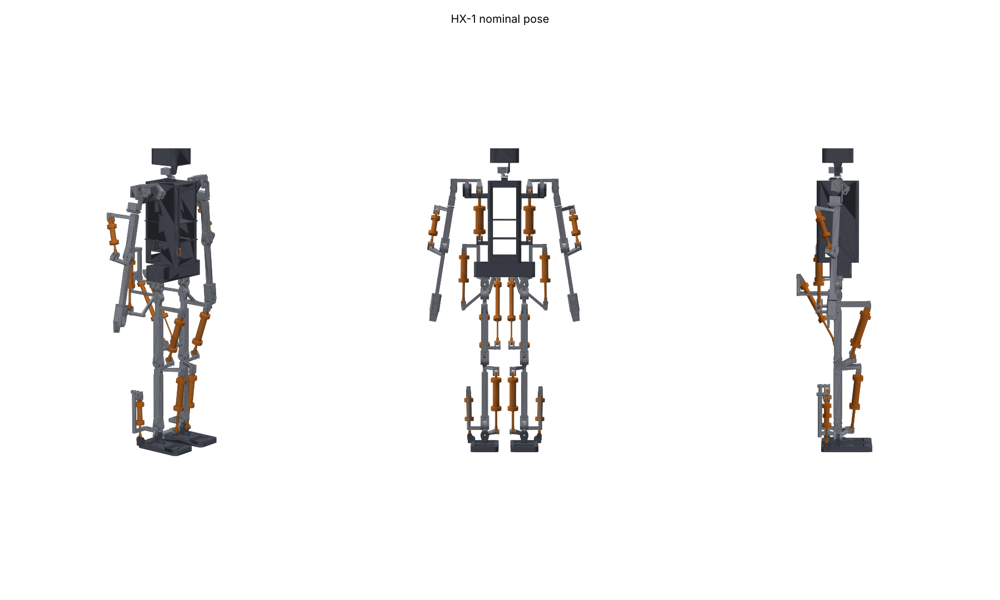
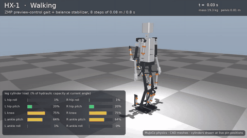
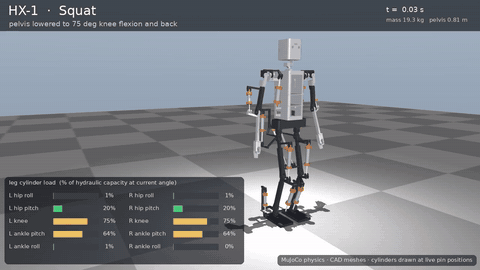
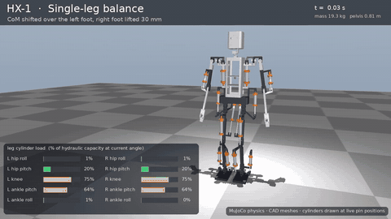
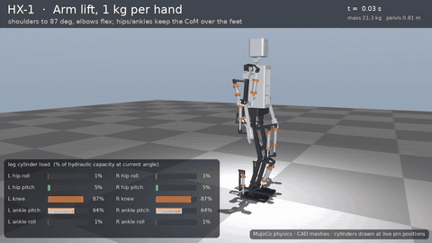

# HX-1 — an open, 3D-printable hydraulic humanoid

HX-1 is a ~1.4 m, ~19 kg biped humanoid with **14 low-pressure hydraulic joints**
(printed tie-rod cylinders driven by servo-positioned proportional spool valves)
and 10 hobby/industrial servo joints. Structural and hydraulic parts are designed
to print on an **Elegoo Neptune 4 Max** (420 × 420 × 480 mm).

The repository is an end-to-end, *self-checking* design. **CAD/STL, simulation,
firmware, wiring and QA are all generated from one file:** [`config/robot.yaml`](config/robot.yaml).



## Simulation videos

Every clip is the **same MuJoCo physics run the QA evaluates**, rendered with the real CAD parts.
The cylinders are drawn each frame between their actual pin locations. The HUD shows each leg
cylinder's load as a percentage of its hydraulic capacity at the current joint angle.

| Walking (8 steps) | Squat (75° knees) |
|---|---|
|  |  |
| **Single-leg balance** | **Arm lift, 1 kg per hand** |
|  |  |

Full-resolution MP4s (1280×720, 30 fps): [walk](docs/video/walk.mp4) · [squat](docs/video/squat.mp4) ·
[single-leg](docs/video/single_leg.mp4) · [arm lift](docs/video/arm_lift.mp4) · [stand](docs/video/stand.mp4) ·
**[all tasks montage](docs/video/hx1_tasks.mp4)**. Regenerate with `make videos`.

> ⚠️ **Hydraulics can injure.** Read [docs/09_safety.md](docs/09_safety.md) before you build
> anything that holds pressure. Printed pressure parts must pass the proof test in
> [docs/08_quality_assurance.md](docs/08_quality_assurance.md) before use.

## What's inside

| area | what you get | where |
|---|---|---|
| **CAD / STL** | 54 parametric part designs → 66 STL files (L/R mirrored), 167 printed pieces in total, 10 packed bed plates, print plan, BOM with cylinder cut list | [`hx/cad`](hx/cad), [`cad/stl`](cad/stl), [`cad/plates`](cad/plates), [`cad/print_plan.md`](cad/print_plan.md), [`cad/bom.csv`](cad/bom.csv) |
| **Hydraulic design** | cylinder + linkage synthesis per joint (bore, stroke, pin locations) against simulated torque demand; HPU pump/accumulator check | [`hx/hydraulics.py`](hx/hydraulics.py), [docs/02](docs/02_hydraulics.md) |
| **Simulation** | MuJoCo model generated from the config + CAD mass properties; ZMP preview-control walking with a balance stabilizer, squat, single-leg balance, arm lift; rendered task videos | [`hx/sim`](hx/sim), [`docs/video`](docs/video), [docs/07](docs/07_simulation.md) |
| **Firmware** | portable C++17 core (joint impedance/force/position control, valve mapping, supervisor, HPU), ESP32-S3 node app, 24 unit tests | [`firmware`](firmware), [docs/06](docs/06_firmware.md) |
| **Software-in-the-loop** | the *real* firmware core (via a C API) controls a hydraulic plant model replaying the simulated gait | [`hx/sim/sil.py`](hx/sim/sil.py) |
| **Electronics** | netlists for limb + hub boards, ERC, generated pin map, power budget, fusing/wire gauge, CAN load, wiring diagram | [`electronics`](electronics), [docs/05](docs/05_electronics.md) |
| **Brain** | Raspberry Pi runtime: arming interlocks, gait streaming over 2× CAN | [`hx/brain`](hx/brain) |
| **Recursive QA** | design QA tree (47 checks traced to 39 requirements) + physical build QA log (part → cylinder → joint → limb → robot) | [`hx/qa`](hx/qa), [`qa/report.md`](qa/report.md), [docs/08](docs/08_quality_assurance.md) |

The headline numbers (mass, cylinder sizes, SIL tracking, power) are in the auto-generated
**[design summary](docs/00_design_summary.md)**.

## The recursive design loop

```
              ┌────────────────────────── config/robot.yaml ──────────────────────────┐
              ▼                                                                       │
   masses ──► MuJoCo whole-body sim ──► torque/velocity demand ──► cylinder+linkage   │
     ▲          (walk, squat, 1-leg,        (angle-binned            synthesis         │
     │           arm lift)                  envelopes)               (bore, stroke,    │
     │                                                               pin locations)    │
     └──── CAD mass properties ◄── parametric CAD (manifold3d) ◄─────────┘             │
                                        │                                              │
                                        ├─► STL + plates + print plan + BOM            │
                                        ├─► assembly interference over ~120 poses      │
                                        └─► firmware gains/linkage tables ─► SIL ──────┘
                                                                   (real firmware vs plant)
```

`python -m hx loop` iterates until the cylinder selection is stable and total mass changes by
less than 2 % (with hysteresis so the loop cannot limit-cycle). The QA tree then verifies every
level; a level passes only if all of its children pass.

## Quick start

```bash
pip install -r requirements.txt
```

```bash
make all        # design loop -> codegen -> CAD/STL -> renders -> firmware tests -> SIL -> videos -> QA
```

```bash
make qa-fast    # re-run the QA tree using cached SIL results
```

Individual stages: `python -m hx {loop|sim|size|cad|asm|render|video|gen|sil|qa}` (see `python -m hx -h`).

Firmware:

```bash
make fw-test                                   # host build + unit tests
```

```bash
cd firmware/platform/esp32s3 && pio run -e leg_L -t upload   # flash a node (needs PlatformIO)
```

## Build order (physical)

1. Read [safety](docs/09_safety.md). Print `fit_coupon.stl` in each material, record fits in `qa/build_log.yaml`.
2. Print parts per [`cad/print_plan.md`](cad/print_plan.md) ([printing guide](docs/03_printing.md)).
3. Build and **proof-test every cylinder** ([QA guide](docs/08_quality_assurance.md)).
4. Assemble joints → limbs → robot ([assembly guide](docs/04_assembly.md)); wire per [electronics](docs/05_electronics.md).
5. Flash nodes, calibrate encoders, bench-test each joint, then bring up on a gantry ([firmware](docs/06_firmware.md)).
6. `python -m hx qa` rolls your measurements up the build tree; the robot is signed off when `System bring-up` passes.

## Repository layout

```
config/robot.yaml          single source of truth (+ requirements.yaml, robot.schema.json)
config/derived/*.json      design-loop outputs (demand, sizing, mass props, SIL, ...) with config hash
hx/                        Python package: config, hydraulics, sim, cad, codegen, electronics, brain, qa
cad/stl, cad/plates        printable files (generated)            docs/          guides + renders
firmware/core              portable C++ control core + generated headers
firmware/platform/esp32s3  PlatformIO node application            firmware/tests  unit tests
electronics/               boards.yaml, parts.yaml, generated netlists/wiring/power reports
qa/                        report.md (generated), build_log.yaml (you fill it in)
```

## Honest limitations

- Simulation uses idealised joint servos to derive demand; the hydraulic SIL then checks each joint
  type in isolation against that demand. Whole-body hydraulic co-simulation is future work.
- Videos need a headless OpenGL backend (`apt install libegl1 libosmesa6`) and ffmpeg; CI installs both.
- The ESP32 cross-compile is run by CI (`pio run`); in restricted environments the QA only compiles
  the node application against Arduino API stubs.
- Printed pressure parts are viable at the low design pressure (15 bar) **only** with the specified
  materials and settings, and only after a per-cylinder proof test. Treat every cylinder as suspect
  until it passes.
- Off-the-shelf parts in the BOM are specified by class and rating, not by brand; check datasheets
  against the listed ratings.

## Licence

Hardware design files are under CERN-OHL-S-2.0 and software under MIT; see [`LICENSE`](LICENSE).
