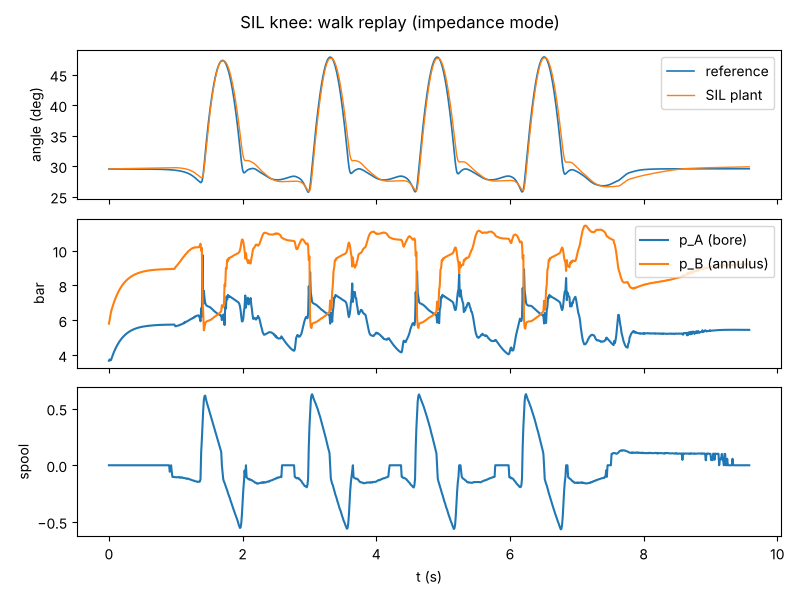
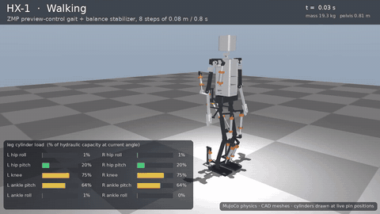
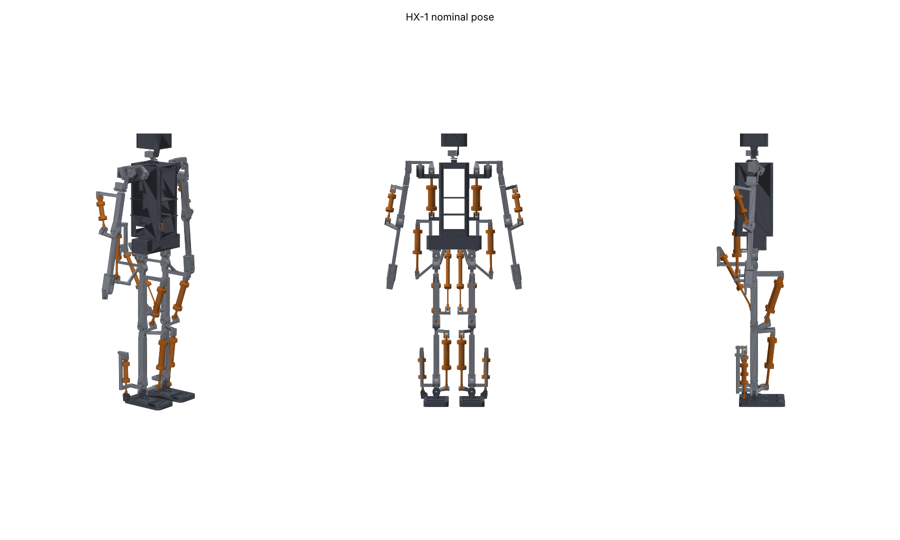
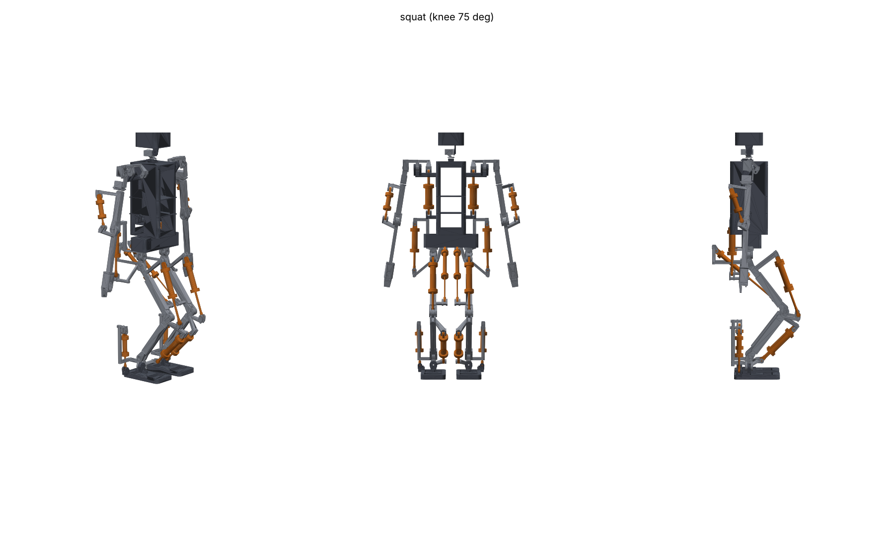
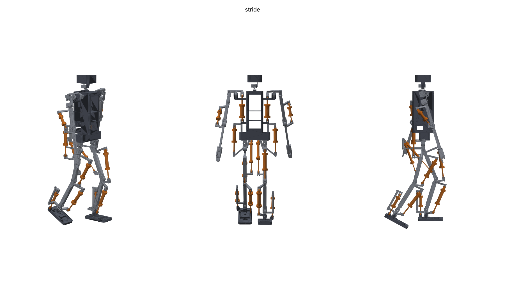
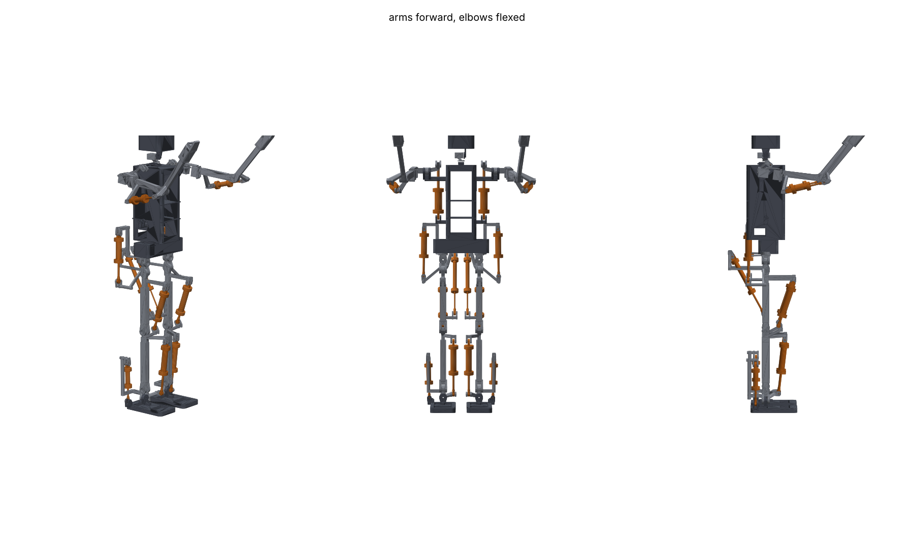
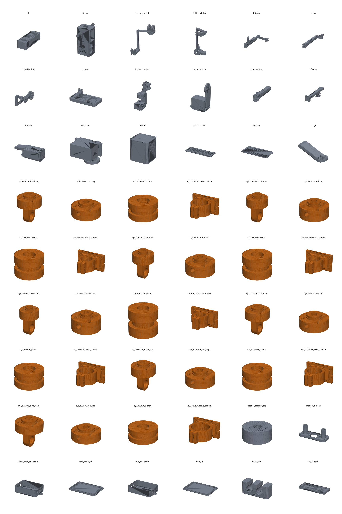

# HX-1 design summary

Auto-generated from `config/robot.yaml` (`68faa233b24d373e`) and the design-loop outputs in `config/derived/`. Regenerate with `make all`.

## Key figures

| quantity | value |
|---|---|
| total mass (no payload) | 19.35 kg |
| printed structure | 8.33 kg, ~190 h printing on the Neptune 4 Max |
| height (standing) | ~1.40 m |
| actuated DOF | 24 (14 hydraulic, 10 servo) |
| supply / relief pressure | 15.0 / 17.0 bar |
| pump flow / accumulator usable | 7.65 L/min / 87 mL |
| design loop | converged in 2 iterations |

## Hydraulic actuators (left side; right is mirrored)

| joint | bore x stroke (mm) | rod | moment arm (mm) | peak demand (N m) | capacity ratio | peak flow (L/min) | cylinder mass (g) |
|---|---|---|---|---|---|---|---|
| ankle_pitch | 25 x 100 | 10 | 46-67 | 15.7 | 1.36 | 3.55 | 381 |
| ankle_roll | 20 x 55 | 8 | 64-71 | 13.9 | 1.14 | 1.24 | 239 |
| elbow | 20 x 40 | 8 | 12-24 | 4.3 | 1.26 | 0.84 | 222 |
| hip_pitch | 16 x 140 | 6 | 35-151 | 12.1 | 1.24 | 1.45 | 271 |
| hip_roll | 25 x 75 | 10 | 82-119 | 21.5 | 1.31 | 1.53 | 338 |
| knee | 25 x 105 | 10 | 43-69 | 17.4 | 1.25 | 4.96 | 390 |
| shoulder_pitch | 32 x 75 | 12 | 12-39 | 8.9 | 1.30 | 2.33 | 430 |

Capacity ratio = min over every simulated (angle, torque) sample of capacity / (1.5 x demand); >= 1 required.

## Simulation scenarios

| scenario | stable | max tilt (deg) | mass (kg) |
|---|---|---|---|
| arm_lift | yes | 0.1 | 21.3 |
| single_leg | yes | 0.7 | 19.3 |
| squat | yes | 0.2 | 19.3 |
| stand | yes | 0.1 | 19.3 |
| walk | yes | 1.4 | 19.3 |

## HPU (pump + accumulator vs scenario flow)

| scenario | peak flow L/min | mean flow L/min | min supply bar | pump duty |
|---|---|---|---|---|
| arm_lift | 5.71 | 2.14 | 13.5 | 0.28 |
| single_leg | 3.79 | 1.36 | 13.5 | 0.14 |
| squat | 3.70 | 1.81 | 13.5 | 0.21 |
| stand | 0.42 | 0.42 | 14.2 | 0.00 |
| walk | 12.59 | 4.47 | 13.3 | 0.58 |

## Hydraulic SIL (real firmware, lumped plant, 15 % feed-forward error)

| joint | step overshoot | settle 5 % | walk RMS / max err (deg) | squat max err (deg) | peak p (bar) | result |
|---|---|---|---|---|---|---|
| ankle_pitch | 2.8 % | 0.09 s | 0.50 / 1.39 | 0.89 | 10.3 | PASS |
| ankle_roll | 1.5 % | 0.08 s | 1.28 / 2.63 | 0.22 | 11.4 | PASS |
| elbow | 0.0 % | 0.11 s | 0.11 / 0.42 | 0.42 | 8.3 | PASS |
| hip_pitch | 4.5 % | 0.11 s | 1.05 / 2.19 | 1.03 | 11.9 | PASS |
| hip_roll | 3.9 % | 0.10 s | 0.86 / 1.93 | 0.17 | 11.2 | PASS |
| knee | 3.5 % | 0.08 s | 0.87 / 2.95 | 1.71 | 11.7 | PASS |
| shoulder_pitch | 1.9 % | 0.10 s | 0.07 / 0.21 | 0.20 | 8.3 | PASS |

## Electrical

- Battery: nominal 263 W, peak 828 W, runtime ~41 min
- CAN load: CAN_A 34 %, CAN_B 38 %
- ERC: 0 errors, 0 warnings

## Mass by body

| body | mass (kg) |
|---|---|
| L_ankle_link | 0.644 |
| L_foot | 0.462 |
| L_forearm | 0.269 |
| L_hand | 0.067 |
| L_hip_roll_link | 0.633 |
| L_hip_yaw_link | 0.522 |
| L_shin | 0.839 |
| L_shoulder_link | 0.348 |
| L_thigh | 0.787 |
| L_upper_arm | 0.483 |
| L_upper_arm_roll | 0.117 |
| R_ankle_link | 0.644 |
| R_foot | 0.462 |
| R_forearm | 0.269 |
| R_hand | 0.067 |
| R_hip_roll_link | 0.633 |
| R_hip_yaw_link | 0.522 |
| R_shin | 0.839 |
| R_shoulder_link | 0.348 |
| R_thigh | 0.787 |
| R_upper_arm | 0.483 |
| R_upper_arm_roll | 0.117 |
| head | 0.386 |
| neck_link | 0.088 |
| pelvis | 1.175 |
| torso | 7.354 |

## Simulation videos

Same physics runs as the QA, rendered with the CAD parts and live cylinders (`make videos`): [walk](video/walk.mp4) · [squat](video/squat.mp4) · [single-leg](video/single_leg.mp4) · [arm lift](video/arm_lift.mp4) · [stand](video/stand.mp4) · [montage](video/hx1_tasks.mp4)

## Renders

