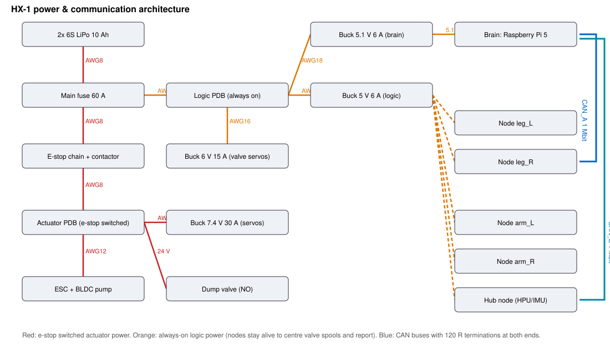

# 05 · Electronics & wiring

## Power tree

| rail | source | e-stop switched | loads |
|---|---|---|---|
| PUMP_BAT 22.2 V | battery via contactor | **yes** | ESC + BLDC pump, dump-valve coil |
| SERVO_7V4 | 30 A buck | **yes** | hip-yaw, shoulder, neck, gripper servos |
| VALVE_6V | 15 A buck | no | 14 valve micro-servos (firmware centres them on e-stop) |
| LOGIC_5V | 6 A buck | no | ESP32 nodes, sensors, encoders, IMU, fan |
| BRAIN_5V | 6 A buck | no | Raspberry Pi 5 + USB-CAN adapters |

The **e-stop chain** (mushroom button + optional wireless receiver in series) drives the coil
of an 80 A contactor. Opening it de-energises the pump, the joint servos and the **normally-open
dump valve**, which bleeds the accumulator to tank. The logic stays alive. Each node senses the
actuator bus through an optocoupler (`ESTOP_SENSE`), enters `ESTOP` and centres every spool
(closed centre = joints locked, no motive pressure). See [09_safety](09_safety.md).

The generated budget, fusing and wire-gauge tables are in
[`electronics/generated/power_harness.md`](../electronics/generated/power_harness.md). QA
enforces regulator ≥ 1.2 × peak, fuse ≤ wire ampacity, and wire load ≤ 80 %.

## Boards

Both boards are carrier boards for an **ESP32-S3-DevKitC-1 (WROOM-1-N8)**. They can be built on
2-layer PCB or perfboard. Full component/net lists are in
[`limb_netlist.md`](../electronics/generated/limb_netlist.md) and
[`hub_netlist.md`](../electronics/generated/hub_netlist.md).

### Limb board (×4: leg_L, leg_R, arm_L, arm_R)

| function | GPIO | notes |
|---|---|---|
| CAN TX / RX | 4 / 5 | SN65HVD230, 120 Ω jumper |
| SPI SCLK / MOSI / MISO | 12 / 11 / 13 | shared by encoders and ADCs |
| encoder CS 0-5 | 14, 15, 16, 17, 18, 21 | AS5048A, shielded JST-GH cable ≤ 0.6 m |
| ADC CS 0-1 | 10, 9 | 2× MCP3208 at 3.3 V |
| PWM 0-4 | 39, 40, 41, 42, 47 | valve micro-servos at 333 Hz (6 V rail) |
| PWM 5-7 | 1, 6, 7 | joint servos (7.4 V rail); ch5 at 333 Hz, ch6-7 at 50 Hz |
| e-stop sense | 2 | PC817 + 4.7 k from the actuator bus, 10 k pull-up |
| status LED | 8 | |

Pressure transducers are 5 V ratiometric (0.5–4.5 V). They pass through a **10 k/20 k divider +
10 nF** into the 3.3 V ADC (max 3.0 V), which the ERC verifies. The ERC also checks: every net has
≥ 2 connections, no pin sits on two nets, supply ranges, abs-max input voltages, single push-pull
driver per net, ESP32-S3 reserved/strapping/USB/flash pins, the onboard RGB-LED pins, ADC1-only
analog inputs, ≤ 8 LEDC channels, and decoupling per IC.

### Hub board (torso)

IMU (BNO085, I²C 41/42), ESC PWM (21), dump-valve MOSFET (47, **HIGH = closed**), fan (18), neck
servos (14, 15), supply/accumulator pressure via MCP3208 (CS 10), battery voltage (GPIO1, 100 k/12 k),
battery current (ACS758, GPIO6), oil NTC (GPIO7), level switch (16), e-stop sense (17).

## CAN

Two 1 Mbit buses keep the load below 40 % (QA `ELE-4`): **CAN_A** = legs, **CAN_B** = arms + hub.
Daisy-chain with 4-pin JST-XH (CANH, CANL, GND, 5 V), twisted pair, and terminate both ends.
The protocol is generated into `firmware/core/include/hx/can_protocol.h` and `hx/protocol.py`.

## Grounding & EMI

* Star ground at the power distribution board; logic ground joins the battery negative at one point only.
* Route encoder and SPI cables away from the ESC/motor leads; ferrite on the ESC input.
* Keep the valve-servo 6 V rail separate from the 7.4 V joint-servo rail (different regulators)
  so stall currents cannot brown out the valves.
